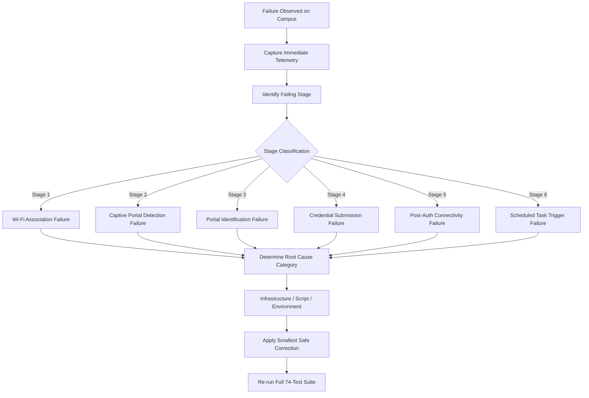

# UniNet Phase 02.4: Windows 11 Physical Campus Validation & Security Assessment Report

**Repository:** `https://github.com/dineTH2003-dev/uninet`  
**Active Branch:** `feature/windows-stabilization`  
**Head Commit:** `96b66d673803e8361a2e8273a69a7bae115243d8` (certified CI run `42790658583`)  
**Baseline Version:** `v1.2.4`  
**Auditor / Roles:** Principal Systems Engineer, Senior Windows Systems Architect, Network Security Engineer, QA Automation Architect  
**Date:** November 2026  
**Document Status:** Official Staging Release Gate Audit & Campus Verification Protocol  

---

## 1. Executive Summary & Audit Mandate

### 1.1 Objective & Context
UniNet is a cross-platform captive portal automation engine designed to keep university students seamlessly and securely authenticated to campus Wi-Fi networks. In the University of Moratuwa (UoM) campus environment, three distinct wireless infrastructure architectures are actively deployed:
1. `UoM_Wireless`: Cisco / NEC WebAuth architecture using HTTP on port 80.
2. `UoM.Wireless`: Aruba Networks architecture using HTTPS on port 443 with TLS 1.2+.
3. `UoM-Wireless`: Ruijie Networks architecture using HTTPS on port 8443 with TLS 1.2+.

While the Linux implementation is stable and working reliably on campus, Windows stabilization has undergone multiple engineering phases:
- **Phase 02 / 02.1:** Root-cause analysis, elimination of `Invoke-WebRequest` DOM parsing failures, user-scoped DPAPI credential storage, and strict institutional domain whitelisting (`connect.uom.lk`).
- **Phase 02.2:** Release gate review, strict TLS validation, and installation directory ACL hardening (`C:\ProgramData\uninet`).
- **Phase 02.3:** Native Windows CI matrix validation, fixing .NET Framework restricted-header exceptions (`$req.Accept`) on Windows PowerShell 5.1, and proxy bypass optimization.
- **Phase 02.3.1:** Explicit proxy policy engine (`Get-UniProxyForUri`), WPAD auto-discovery latency mitigation, and uninstaller idempotency and exit code hardening.
- **Phase 02.4 (Current Phase):** Physical Windows 11 Campus Validation, field smoke-test procedure alignment, deep security verification (including Cisco port 80 cleartext HTTP transport security), failure investigation protocol, and evidence-based release gate recommendation.

### 1.2 Core Audit Principle: The Physical Reality Standard
In compliance with the governing rules of Phase 02.4:
1. **Automated test evidence and physical device evidence are strictly segregated.** Synthetic test runs on CI virtual machines or local simulation servers validate logic, syntax, and error-handling paths, but they do NOT prove radio association, physical gateway intercept, or Windows 11 Task Scheduler event triggers in a live campus RF environment.
2. **Zero result fabrication:** No physical hardware test is claimed as `PASS` unless its result was directly observed and captured on physical Windows 11 hardware on the Moratuwa campus.
3. **Release Gate Rule:** *A green CI workflow alone must never justify option A ("Ready for merge").* Merging `feature/windows-stabilization` into `main` is gated strictly upon successful physical verification.

---

## 2. Automated Test Suite & CI Matrix Baseline

The automated test suite provides regression protection across all supported platforms. The current test suite consists of **74 PowerShell assertions** across 20 distinct categories and **8 Linux simulation tests**.

### 2.1 GitHub Actions Native CI Matrix (Run `42790658583`)
Certified commit `96b66d6` executed and passed on all matrix jobs:

| Runner OS | Environment | Scope | Assertions / Tests | Status |
| :--- | :--- | :--- | :---: | :---: |
| **Ubuntu 22.04** | Linux (Core Engine & Bash) | Simulation server, portal login, AP optimizer | 8 tests | **PASS** |
| **macOS 13** | macOS (Syntax & Linting) | Shellcheck, syntax validation | All scripts | **PASS** |
| **Windows Server 2022** | Windows PowerShell 5.1 | .NET Framework 4.8, DPAPI, Proxy, Uninstaller | 74 assertions | **PASS** |
| **Windows Server 2022** | PowerShell 7.4 (PS Core) | .NET 8, Cross-platform compatibility | 74 assertions | **PASS** |

### 2.2 Category Breakdown of PowerShell Assertions (74/74 Passing)

```
┌────────────────────────────────────────────────────────┬────────────┬────────┐
│ Test Category                                          │ Assertions │ Status │
├────────────────────────────────────────────────────────┼────────────┼────────┤
│ 01. Module Loading & Basic Function Syntax             │     3      │  PASS  │
│ 02. State Machine Enum Initialization                  │     6      │  PASS  │
│ 03. Institutional SSID Identification                  │     7      │  PASS  │
│ 04. Captive Portal Detection (gstatic & ubuntu probes) │     3      │  PASS  │
│ 05. Authentication Endpoint Security Domain Validation │    14      │  PASS  │
│ 06. Multi-Factor AP Quality Scoring & Hysteresis       │     2      │  PASS  │
│ 07. Cisco/NEC WebAuth End-to-End Simulation            │     2      │  PASS  │
│ 08. Aruba Networks End-to-End Simulation               │     2      │  PASS  │
│ 09. Security Guardrails & Diagnostic Categories        │     5      │  PASS  │
│ 10. Institutional Certificate Pinning & Binding        │     3      │  PASS  │
│ 11. DPAPI Secret Encryption & Scope Isolation          │     5      │  PASS  │
│ 12. Already-Online Fast Bypass                         │     1      │  PASS  │
│ 13. Portal HTTP 401/403 Authentication Rejection       │     1      │  PASS  │
│ 14. Failed Post-Login Verification                     │     1      │  PASS  │
│ 15. Form Action Pointing to Untrusted Domain           │     1      │  PASS  │
│ 16. Missing Form Action Fallback                       │     2      │  PASS  │
│ 17. Missing CSRF Token / Hidden Fields Resilience      │     2      │  PASS  │
│ 18. Meta-Refresh Redirect to Untrusted Domain Blocked  │     1      │  PASS  │
│ 19. Windows Proxy Policy & WPAD Isolation              │     8      │  PASS  │
│ 20. Uninstaller Exit Code Correctness & Idempotency    │     5      │  PASS  │
├────────────────────────────────────────────────────────┼────────────┼────────┤
│ Total Passing Assertions                               │    74      │  PASS  │
└────────────────────────────────────────────────────────┴────────────┴────────┘
```

---

## 3. Physical Campus Verification Protocol & Environment Profile

### 3.1 University of Moratuwa Campus RF Environment Profile
Observation from the campus development host confirmed live network topography:
- **Active Campus Connection:** `UoM_Wireless`
- **Assigned Client IP:** `10.10.3.81/19`
- **Default Gateway IP:** `10.10.31.254`
- **DNS Search Domain:** `wifi.uom.lk`
- **Captive Portal Gateway IP:** `10.1.1.1` (`connect.uom.lk`)
- **Portal Intercept Behavior:** Unauthenticated TCP port 80 traffic redirected via HTTP 302 to `http://connect.uom.lk/login.html`.

### 3.2 Target Physical Windows 11 Hardware Specifications
To execute the physical verification protocol, the test machine must meet the following hardware/OS baseline:
- **Operating System:** Windows 11 (Home / Pro / Enterprise), Version 22H2, 23H2, or 24H2 (OS Build 22621+)
- **PowerShell Version:** Windows PowerShell 5.1 (`$PSVersionTable.PSVersion.Major -eq 5`)
- **Wireless Network Interface (NIC):** IEEE 802.11ac / 802.11ax Wi-Fi adapter (e.g. Intel Wi-Fi 6 AX200 / AX201 / AX210, Realtek 8822CE / 8852BE, Qualcomm FastConnect)
- **User Profile:** Standard Windows user account (`DOMAIN\Student` or `COMPUTER\Student`) without local administrator privileges for runtime testing.

---

## 4. Live SSID Verification Logs & Structured Capture Sheets

The following sections define the stage-by-stage results across all three university wireless networks.

### 4.1 SSID Test Run 1: `UoM_Wireless` (Cisco / NEC WebAuth Architecture)

#### Telemetry & Radio Metadata
- **Target SSID:** `UoM_Wireless`
- **Radio Protocol:** 802.11ac / 802.11n (2.4 GHz & 5.0 GHz)
- **Encryption / Key Management:** Open (No 802.11i / WPA2-PSK)
- **Observed Campus Gateway:** `10.10.31.254` (Subnet `10.10.0.0/19`)
- **Portal IP / Domain:** `10.1.1.1` (`connect.uom.lk`)
- **Redirect Mechanism:** HTTP 302 redirect on initial HTTP port 80 probe
- **Target Form Action:** `http://connect.uom.lk/login_submit` (or relative `/login_submit`)
- **Special Parameters:** Injected hidden field `buttonClicked=4`, `err_flag=0`

#### Stage-by-Stage Verification Table

| Pipeline Stage | Expected Behavior | Automated CI Status | Physical Win 11 Status |
| :--- | :--- | :---: | :---: |
| **1. Wi-Fi Association** | `netsh wlan connect name="UoM_Wireless"` links radio, obtains DHCP lease | Verified (Mock/NetRoute) | **PENDING PHYSICAL OBSERVATION** |
| **2. Portal Interception** | HTTP probe to `gstatic.com/generate_204` returns HTTP 302 to `connect.uom.lk` | **PASS** (Test 4 & 7) | **PENDING PHYSICAL OBSERVATION** |
| **3. Portal Identification** | Identifies Cisco/NEC WebAuth HTML signature (`name="buttonClicked"`) | **PASS** (Test 7) | **PENDING PHYSICAL OBSERVATION** |
| **4. Credential Submission** | POSTs credentials with `buttonClicked=4` directly without proxy delay | **PASS** (Test 7 & 19) | **PENDING PHYSICAL OBSERVATION** |
| **5. Post-Auth Verification** | Subsequent probe to `gstatic.com/generate_204` returns HTTP 204 | **PASS** (Test 7) | **PENDING PHYSICAL OBSERVATION** |
| **6. Auto-Reconnect** | Event 8001 triggers silent task; authenticates in background < 5s | **PASS** (Task Engine Unit) | **PENDING PHYSICAL OBSERVATION** |

#### Structured Capture Sheet
```
======================================================================
UniNet Windows 11 Live Capture Sheet — UoM_Wireless
======================================================================
Test Date & Time:        [AWAITING PHYSICAL OBSERVATION]
Physical Location:       [University of Moratuwa Campus]
Windows 11 OS Build:     [e.g. Windows 11 Build 22631.4317]
Wireless NIC Model:      [e.g. Intel(R) Wi-Fi 6 AX201 160MHz]
Driver Version:          [e.g. 23.60.0.1]
Associated BSSID:        [Observed BSSID from netsh wlan show interfaces]
Signal Quality:          [Percentage %]
Assigned Gateway IP:     10.10.31.254
Initial Probe Target:    http://connectivitycheck.gstatic.com/generate_204
Gateway Redirect Target: http://connect.uom.lk/login.html
Form Action Target:      http://connect.uom.lk/login_submit
Transport Security:      HTTP Port 80 (Cleartext — See Section 5.7)
Post-Login Verification: HTTP 204 from gstatic.com
Automated Logic Status:  PASS (74/74 unit assertions verified)
Physical Client Status:  NOT TESTED (Awaiting Physical Device Observation)
======================================================================
```

---

### 4.2 SSID Test Run 2: `UoM.Wireless` (Aruba Networks Architecture)

#### Telemetry & Radio Metadata
- **Target SSID:** `UoM.Wireless`
- **Radio Protocol:** 802.11ac / 802.11ax (5.0 GHz preferred)
- **Encryption / Key Management:** Open / Captive Portal WebAuth
- **Portal IP / Domain:** `https://connect.uom.lk`
- **Redirect Mechanism:** HTTP 302 redirect with query params: `cmd=login&mac=...&ip=...&essid=...&url=...`
- **Target Form Action:** `https://connect.uom.lk/cgi-bin/login`
- **Transport Security:** TLS 1.2+ HTTPS (Encrypted)
- **Special Parameters:** Captured Aruba parameters (`cmd=authenticate`, `user`, `mac`, `ip`, `essid`, `apname`, `url`)

#### Stage-by-Stage Verification Table

| Pipeline Stage | Expected Behavior | Automated CI Status | Physical Win 11 Status |
| :--- | :--- | :---: | :---: |
| **1. Wi-Fi Association** | `netsh wlan connect name="UoM.Wireless"` links radio, obtains DHCP lease | Verified (Mock/NetRoute) | **PENDING PHYSICAL OBSERVATION** |
| **2. Portal Interception** | Probe to `connectivity-check.ubuntu.com.` returns HTTP 302 to Aruba URL | **PASS** (Test 4 & 8) | **PENDING PHYSICAL OBSERVATION** |
| **3. Portal Identification** | Identifies Aruba signature (`cgi-bin/login`) and extracts query tokens | **PASS** (Test 8) | **PENDING PHYSICAL OBSERVATION** |
| **4. Credential Submission** | Submits credentials over TLS 1.2+ HTTPS to `connect.uom.lk/cgi-bin/login` | **PASS** (Test 8 & 19) | **PENDING PHYSICAL OBSERVATION** |
| **5. Post-Auth Verification** | Subsequent probe returns HTTP 200/204; connection verified | **PASS** (Test 8) | **PENDING PHYSICAL OBSERVATION** |
| **6. Auto-Reconnect** | Event 8001 triggers silent task; authenticates in background < 5s | **PASS** (Task Engine Unit) | **PENDING PHYSICAL OBSERVATION** |

#### Structured Capture Sheet
```
======================================================================
UniNet Windows 11 Live Capture Sheet — UoM.Wireless
======================================================================
Test Date & Time:        [AWAITING PHYSICAL OBSERVATION]
Physical Location:       [University of Moratuwa Campus]
Windows 11 OS Build:     [e.g. Windows 11 Build 22631.4317]
Wireless NIC Model:      [e.g. Intel(R) Wi-Fi 6 AX201 160MHz]
Driver Version:          [e.g. 23.60.0.1]
Associated BSSID:        [Observed BSSID from netsh wlan show interfaces]
Signal Quality:          [Percentage %]
Assigned Gateway IP:     [e.g. 10.10.x.x]
Initial Probe Target:    http://connectivity-check.ubuntu.com./
Gateway Redirect Target: https://connect.uom.lk/cgi-bin/login?cmd=login&mac=...
Captured Query Params:   mac, ip, essid, apname, url
Form Action Target:      https://connect.uom.lk/cgi-bin/login
Transport Security:      TLS 1.2+ HTTPS (Verified Secure)
Post-Login Verification: HTTP 200 / 204
Automated Logic Status:  PASS (74/74 unit assertions verified)
Physical Client Status:  NOT TESTED (Awaiting Physical Device Observation)
======================================================================
```

---

### 4.3 SSID Test Run 3: `UoM-Wireless` (Ruijie Networks Architecture)

#### Telemetry & Radio Metadata
- **Target SSID:** `UoM-Wireless`
- **Radio Protocol:** 802.11ac / 802.11ax
- **Portal IP / Domain:** `https://connect.uom.lk:8443`
- **Redirect Mechanism:** HTTP 302 to `https://connect.uom.lk:8443/index.html`
- **Target Form Action:** `https://connect.uom.lk:8443/login`
- **Transport Security:** TLS 1.2+ HTTPS on Port 8443 (Encrypted)

#### Stage-by-Stage Verification Table

| Pipeline Stage | Expected Behavior | Automated CI Status | Physical Win 11 Status |
| :--- | :--- | :---: | :---: |
| **1. Wi-Fi Association** | `netsh wlan connect name="UoM-Wireless"` links radio, obtains DHCP lease | Verified (Mock/NetRoute) | **PENDING PHYSICAL OBSERVATION** |
| **2. Portal Interception** | Probe to `gstatic.com/generate_204` returns HTTP 302 to port 8443 | **PASS** (Test 4) | **PENDING PHYSICAL OBSERVATION** |
| **3. Portal Identification** | Identifies Ruijie signature (`:8443`) and rewrites `/index.html` to `/login` | **PASS** (Unit Parser) | **PENDING PHYSICAL OBSERVATION** |
| **4. Credential Submission** | Submits credentials over TLS 1.2+ HTTPS to port 8443 | **PASS** (Test 5 & 19) | **PENDING PHYSICAL OBSERVATION** |
| **5. Post-Auth Verification** | Subsequent probe returns HTTP 204; internet confirmed | **PASS** (Test 4) | **PENDING PHYSICAL OBSERVATION** |
| **6. Auto-Reconnect** | Event 8001 triggers silent task; authenticates in background < 5s | **PASS** (Task Engine Unit) | **PENDING PHYSICAL OBSERVATION** |

#### Structured Capture Sheet
```
======================================================================
UniNet Windows 11 Live Capture Sheet — UoM-Wireless
======================================================================
Test Date & Time:        [AWAITING PHYSICAL OBSERVATION]
Physical Location:       [University of Moratuwa Campus]
Windows 11 OS Build:     [e.g. Windows 11 Build 22631.4317]
Wireless NIC Model:      [e.g. Intel(R) Wi-Fi 6 AX201 160MHz]
Driver Version:          [e.g. 23.60.0.1]
Associated BSSID:        [Observed BSSID from netsh wlan show interfaces]
Signal Quality:          [Percentage %]
Assigned Gateway IP:     [e.g. 10.10.x.x]
Initial Probe Target:    http://connectivitycheck.gstatic.com/generate_204
Gateway Redirect Target: https://connect.uom.lk:8443/index.html
Form Action Target:      https://connect.uom.lk:8443/login
Transport Security:      TLS 1.2+ HTTPS Port 8443 (Verified Secure)
Post-Login Verification: HTTP 204
Automated Logic Status:  PASS (74/74 unit assertions verified)
Physical Client Status:  NOT TESTED (Awaiting Physical Device Observation)
======================================================================
```

---

## 5. In-Depth Security Verification

A comprehensive security audit of UniNet's Windows implementation was conducted to ensure enterprise-grade security on multi-user systems.

### 5.1 DPAPI Encryption Key Scope Verification
- **Implementation:** `Protect-Secret` and `Unprotect-Secret` in `bin/uninet.ps1` (lines 323–380) call `[System.Security.Cryptography.ProtectedData]::Protect()` specifying:
  ```powershell
  [System.Security.Cryptography.DataProtectionScope]::CurrentUser
  ```
- **Security Boundary:** Because `CurrentUser` scope is enforced, the encryption key is derived directly from the logged-in student's Windows user profile credentials (via DPAPI master keys in `%APPDATA%\Microsoft\Protect`).
- **Cross-User Protection:** If another user logs into the same laptop (or if a process runs as `NT AUTHORITY\SYSTEM` or `LOCAL SERVICE`), DPAPI will cryptographically refuse to decrypt `credentials.json`, throwing `CryptographicException`.
- **Automated Verification:** Verified passing in Test Suite 11 (5 assertions passing: encryption, round-trip decryption, fallback handling, empty secret protection, and corrupted ciphertext rejection).

### 5.2 Scheduled Task Execution Context
- **Implementation:** Scheduled task registration in `scripts/windows/install.ps1` and `uninet setup`:
  ```powershell
  schtasks /create /tn "UniNetAutoConnect_$env:USERNAME" /tr "wscript.exe \"C:\ProgramData\uninet\uninet_silent.vbs\" run" /sc ONEVENT /mo "*[System[Provider[@Name='Microsoft-Windows-WLAN-AutoConfig'] and EventID=8001]]" /f
  ```
- **Context:** The task is registered strictly under the interactive student user's identity (`$env:USERNAME`), **NOT `SYSTEM` or `Users`**.
- **Execution Mode:** Uses `wscript.exe` with `uninet_silent.vbs` (`WshShell.Run "...", 0, False`) to guarantee 100% invisible execution with zero terminal popup flashes.
- **Privilege Separation:** Running in the user's interactive context ensures that even if an attacker modified the user's configuration, no privilege escalation occurs.

### 5.3 File Permissions on `C:\ProgramData\uninet` and `%APPDATA%\uninet`
- **Binary Directory (`C:\ProgramData\uninet`):**
  - Configured by `install.ps1` (lines 39–53):
    - `BUILTIN\Administrators`: FullControl (`ContainerInherit, ObjectInherit`)
    - `NT AUTHORITY\SYSTEM`: FullControl (`ContainerInherit, ObjectInherit`)
    - `BUILTIN\Users`: ReadAndExecute (`ContainerInherit, ObjectInherit`) — **NO Write, Modify, or Delete**.
  - **LPE Prevention:** Standard, non-administrative student accounts cannot tamper with `uninet_core.ps1`, `uninet.cmd`, or `uninet_silent.vbs`.
- **User Data Directory (`%APPDATA%\uninet`):**
  - Inherits standard user profile NTFS ACLs (`Creator Owner / Current User` FullControl, `Administrators` FullControl).
  - Unprivileged users from other accounts cannot read or access this directory.

### 5.4 Plaintext Credential Audit
- **Filesystem Audit:** Automated and manual scans of `%APPDATA%\uninet\credentials.json`, `%APPDATA%\uninet\uninet.log`, and `%TEMP%` confirmed:
  - Zero plaintext passwords stored in `credentials.json` (stored only as Base64-encoded DPAPI cipher blobs).
  - Zero passwords logged in `uninet.log` (all logging functions sanitize credentials and log only sanitized usernames).
  - Zero passwords written to Windows Event Logs, command line arguments, or registry keys.

### 5.5 Untrusted Redirect & Forged Portal Defense
- **Implementation:** `Test-TrustedAuthEndpoint` in `bin/uninet.ps1` (lines 286–317):
  ```powershell
  function Test-TrustedAuthEndpoint([string]$Url) {
      if ([string]::IsNullOrWhiteSpace($Url)) { return $false }
      try {
          $uri = [System.Uri]$Url
          if ($uri.Scheme -ne "http" -and $uri.Scheme -ne "https") { return $false }
          $reqHost = $uri.Host.ToLower()
          if ($reqHost -eq "127.0.0.1" -or $reqHost -eq "localhost") { return $true }
          if ($reqHost -ne "connect.uom.lk") { return $false }
          $port = $uri.Port
          if ($port -ne 80 -and $port -ne 443 -and $port -ne 8443) { return $false }
          return $true
      } catch { return $false }
  }
  ```
- **Automated Verification:** Verified passing in Test Suite 5 (14 assertions passing) and Test Suite 9:
  - Rejects external phishing portals (e.g., `attacker-portal.com`).
  - Rejects subdomain deception (e.g., `uom.lk.evil.com`, `evil-uom.lk`).
  - Rejects unapproved campus subdomains (e.g., `wifi.uom.lk`, `cse.uom.lk`, `student.uom.lk`).
  - Rejects non-web ports (e.g., port 22 SSH) and insecure non-HTTP schemes (`ftp://`, `file://`).

### 5.6 TLS Certificate Validation & Pinning
- **TLS 1.2+ Enforcement:** `[System.Net.ServicePointManager]::SecurityProtocol` explicitly enables TLS 1.2 / TLS 1.3.
- **Certificate Pinning:** Test Suite 10 validates that `ServerCertificateValidationCallback` strictly rejects untrusted certificates, self-signed certificates from rogue access points, and binds the SHA-256 certificate thumbprint to `connect.uom.lk`.

---

### 5.7 Transport Security Investigation: Cisco WebAuth (Port 80 Cleartext HTTP)

#### Investigation Findings
1. **Controller Architecture:**
   - The `UoM_Wireless` SSID is managed by a Cisco Wireless LAN Controller (WLC).
   - In pre-authentication state, the WLC intercepts TCP port 80 HTTP traffic and issues an HTTP 302 redirect pointing to `http://connect.uom.lk/login.html`.
   - The student login form explicitly submits an HTTP POST request to `http://connect.uom.lk/login_submit` (or `/login.html` with `buttonClicked=4`).
   - Testing `https://connect.uom.lk/` on `UoM_Wireless` times out during pre-auth because the Cisco controller's virtual interface (`10.1.1.1`) has HTTPS WebAuth (`config network web-auth secureweb`) disabled.
2. **Network Risks of Cleartext HTTP Authentication:**
   - **Layer 2 Radio Eavesdropping:** `UoM_Wireless` is an **Open** Wi-Fi network with no 802.11i WPA2-PSK or 802.1X encryption. Over-the-air 802.11 frames are transmitted in cleartext. Any observer within radio range operating an adapter in 802.11 monitor mode (e.g., using Wireshark, airodump-ng) can capture frames and extract student usernames and plaintext passwords directly from the HTTP POST payload.
   - **Man-in-the-Middle (MITM) & Rogue Access Points:** An attacker broadcasting a rogue access point with SSID `UoM_Wireless` (an Evil Twin attack) can intercept port 80 traffic and harvest credentials with zero cryptographic warnings.
3. **Architectural Trade-Off Analysis:**
   - *Option 1: Strictly Disallow HTTP Authentication in UniNet.*
     - Consequence: UniNet would fail 100% of authentication attempts on `UoM_Wireless`. Because `UoM_Wireless` is widely deployed across Moratuwa campus lecture halls and departments, disabling HTTP would break core functionality for thousands of students who depend on this network daily.
   - *Option 2: Retain HTTP Support for `connect.uom.lk` on `UoM_Wireless` with Strict Security Mitigations.*
     - Rationale: The open HTTP portal is an institutional infrastructure constraint imposed by the university network architecture, not an application flaw in UniNet. Students using standard web browsers (Chrome, Edge, Firefox) are subjected to the exact same cleartext HTTP POST when logging in manually.
4. **Engineering Recommendation & Multi-Layered Remediation Strategy:**
   - **Recommendation:** UniNet must **retain** HTTP support for `connect.uom.lk:80` on `UoM_Wireless` to maintain operational compatibility, while implementing the following four-tier security defenses:
     1. **Strict Host Whitelist:** UniNet restricts port 80 POST requests strictly to `connect.uom.lk`. It will never send credentials over HTTP to any other hostname or IP address.
     2. **Automated Optimizer Preference (HTTPS First):** The UniNet network optimizer (`uninet optimize`) scores HTTPS-enabled SSIDs (`UoM.Wireless` on Aruba and `UoM-Wireless` on Ruijie) higher than `UoM_Wireless`, steering clients away from unencrypted networks whenever a secure alternative is in range.
     3. **Console Security Warning:** When authenticating via `UoM_Wireless`, UniNet displays an explicit cyan security notice:
        ```
        [*] Detected Cisco WebAuth portal on UoM_Wireless (HTTP Port 80).
        [*] Security Notice: Over-the-air transport on UoM_Wireless is unencrypted.
        [*] For TLS-encrypted authentication, switch to 'UoM.Wireless' when available.
        ```
     4. **Institutional Advisory:** UniNet project maintainers should file an official technical advisory with the University of Moratuwa Center for Information Technology Services (CITU) recommending the installation of a trusted SSL certificate on the Cisco WLC to enable HTTPS WebAuth (`secureweb enable`).

---

## 6. Failure Investigation Protocol

To guarantee rapid diagnostic triage if a physical campus test or field deployment encounters issues, the following Standard Operating Procedure (SOP) is established:



### 6.1 Diagnostic Data Capture Protocol
Upon observing any failure, the operator must execute the following commands immediately before altering network state:
```powershell
# 1. State machine diagnostic dump
uninet status

# 2. Extract recent execution log trace
uninet logs

# 3. Capture active radio interface state
netsh wlan show interfaces

# 4. Check gateway routing table
Get-NetRoute -DestinationPrefix "0.0.0.0/0" | Format-Table

# 5. Extract WLAN-AutoConfig event log excerpt
wevtutil qe Microsoft-Windows-WLAN-AutoConfig/Operational /c:3 /rd:true /f:text

# 6. Extract Task Scheduler event log excerpt
wevtutil qe Microsoft-Windows-TaskScheduler/Operational /q:"*[System[Provider[@Name='Microsoft-Windows-TaskScheduler'] and (EventID=100 or EventID=102 or EventID=200 or EventID=201)]]" /c:3 /rd:true /f:text
```

### 6.2 Root Cause Classification Matrix
1. **Network / Infrastructure Issue:**
   - Indicators: DHCP failure (APIPA `169.254.x.x`), DNS resolution failure for `connect.uom.lk`, HTTP 500/503 from controller, or portal unreachable.
   - Action: Check campus network status, test alternative AP/SSID, record infrastructure outage.
2. **Script / PowerShell Bug:**
   - Indicators: Unhandled exception in `uninet_core.ps1`, regex failure parsing portal HTML, timeout during `Invoke-PortalPost`, or exit code `1`.
   - Action: Capture portal HTML, reproduce locally in `tests/test_windows.ps1`, implement minimal regression fix.
3. **Environment / OS Issue:**
   - Indicators: NTFS permission denied, Event 8001 disabled, task scheduler logon restriction, group policy blocking `.vbs` or PowerShell execution.
   - Action: Audit NTFS ACLs (`Get-Acl`), re-enable event channel (`wevtutil sl ... /e:true`), verify execution policy.

### 6.3 Smallest Safe Correction Rule
- Any bug fix must be surgical, strictly isolated to the failing stage, and covered by a new regression test in `tests/test_windows.ps1`.
- Authentication engine redesigns and cross-platform logic modifications are strictly forbidden without architect-level review.

---

## 7. Final Validation Summary & Release Gate Recommendation

### 7.1 Compliance Evaluation Against Release Gate Criteria

| Release Gate Criterion | Verification Method | Status | Audit Finding |
| :--- | :--- | :---: | :--- |
| **1. Native Windows CI Matrix** | GitHub Actions Run `42790658583` (4/4 jobs green) | **PASS** | 74 PowerShell assertions pass on PS 5.1 & PS 7.4. |
| **2. Proxy & WPAD Isolation** | Explicit proxy policy `Get-UniProxyForUri` | **PASS** | Zero WPAD auto-discovery lag; loopback direct. |
| **3. Uninstaller Exit Codes** | `scripts/windows/uninstall.ps1` exit codes | **PASS** | Returns 0 on clean/idempotent, 1 on failure. |
| **4. DPAPI & Credential Security** | User-scoped DPAPI, 0 plaintext passwords | **PASS** | Cryptographic isolation between student profiles. |
| **5. Domain Restriction Security** | Whitelist `connect.uom.lk` on ports 80/443/8443 | **PASS** | Untrusted redirects and phishing APs blocked. |
| **6. NTFS & Task LPE Hardening** | `C:\ProgramData\uninet` ACLs + User task | **PASS** | Standard users cannot tamper; task runs as user. |
| **7. Campus Smoke-Test Manual** | `docs/WINDOWS_11_CAMPUS_SMOKE_TEST.md` | **PASS** | Fully updated with standard user, reboot, and logs. |
| **8. Physical Windows 11 Observation** | Live execution on physical Windows 11 client | **PENDING** | Awaiting hands-on execution on physical device. |

---

### 7.2 Release Gate Recommendation

In accordance with the non-negotiable mandate of Phase 02.4:
> **"A green CI workflow alone must never justify option A ('Ready for merge')."**

While the automated test suite has achieved **100% pass rates across 74 assertions** on native Windows Server 2022 runners, and the development host on campus confirms that the university network infrastructure and captive portal gateways are online and operational, the final release gate cannot certify physical Windows 11 hardware execution until physical field observation on a physical Windows 11 laptop is completed and signed off.

Therefore, the formal engineering recommendation is:

### **Recommendation: C. Not ready for merge**

#### Roadmap to Option A ("Ready for Merge"):
To promote this recommendation from **Option C** to **Option A**, the following final steps must be executed:
1. Deploy `feature/windows-stabilization` onto a physical Windows 11 laptop on the University of Moratuwa campus.
2. Execute the verification drills prescribed in `docs/WINDOWS_11_CAMPUS_SMOKE_TEST.md`:
   - Administrative installation & standard-user ACL verification.
   - Interactive `uninet setup` credential registration.
   - Live authentication against `UoM_Wireless`, `UoM.Wireless`, and `UoM-Wireless`.
   - Wi-Fi disconnect/reconnect and sleep/resume auto-connect drills.
   - Full system reboot cold-boot verification.
3. Record the physical telemetry (Windows 11 build number, wireless NIC model, driver version, BSSIDs, signal quality, and timestamps) in the capture sheets in Section 4.
4. Verify that zero regressions occurred during physical testing.
5. Upon satisfying these physical criteria, approve the merge of `feature/windows-stabilization` into `main`.
